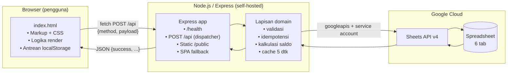
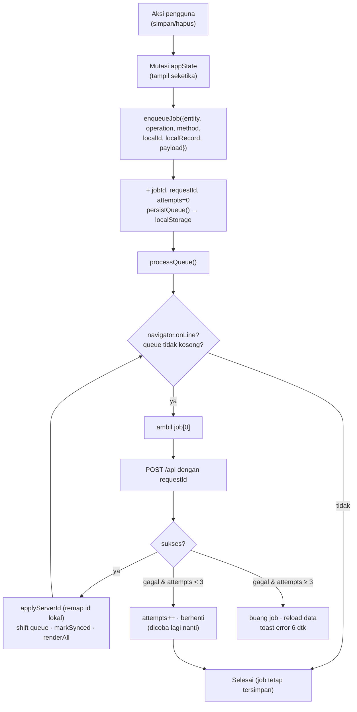

# Financial Manager — Dokumentasi Arsitektur Website

**Jenis dokumen:** Dokumentasi arsitektur & referensi teknis menyeluruh
**Cakupan:** Seluruh website — backend Express, lapisan data Google Sheets, frontend SPA, sistem sinkronisasi, UI/UX, konfigurasi, dan deployment
**Versi aplikasi:** 1.0.0 (`package.json`)
**Basis kode:** `server.js` (1 berkas), `public/index.html` (3.941 baris), `package.json`, `.env.example`
**Tanggal penyusunan:** 31 Oktober 2026

---

## 1. Ringkasan Aplikasi

Financial Manager adalah aplikasi manajemen keuangan pribadi (single-user / self-hosted) berbasis web. Pengguna mencatat pemasukan, pengeluaran, dan transfer antar akun; aplikasi kemudian menghitung saldo tiap akun, menampilkan analisis per kategori, memantau pemakaian anggaran bulanan, serta menyediakan grafik arus kas dan komposisi pengeluaran.

Yang membedakan aplikasi ini dari aplikasi keuangan biasa:

| Aspek | Implementasi |
|---|---|
| **Database** | Google Sheets (bukan RDBMS). Satu spreadsheet berisi 6 tab sebagai tabel. |
| **Backend** | Node.js + Express, memanggil Google Sheets API v4 langsung melalui service account. |
| **Frontend** | Satu berkas HTML statis berisi CSS, markup, dan seluruh logika JavaScript. Tanpa build step, tanpa framework. |
| **Model tulis** | *Offline-first / optimistic UI*. Setiap perubahan langsung tampil di layar, disimpan ke antrean `localStorage`, lalu dikirim ke server secara berurutan. |
| **Autentikasi** | Tidak ada autentikasi pengguna aplikasi. Akses ke spreadsheet dikendalikan oleh service account di sisi server. |
| **Deployment** | Satu proses Node yang melayani API **dan** file statis. Cocok untuk VPS, PM2, Railway/Render, atau hosting Node apa pun. |

Aplikasi **tidak** memakai Google Apps Script. Nama variabel lama (`GAS_WEB_APP_URL`, `FM_API_KEY`) sudah tidak relevan; dokumentasi ini hanya mendeskripsikan kode yang benar-benar ada.

---

## 2. Peta Folder & Berkas

```
financial-manager-sheets-api/
├── server.js                  # Seluruh backend: Express + Google Sheets API (≈ 300 baris)
├── package.json               # Metadata, script, dependensi (ESM: "type": "module")
├── package-lock.json
├── .env.example               # Template variabel environment
├── .env                       # Nilai rahasia aktual (di-ignore Git)
├── .gitignore                 # node_modules/, .env, credentials/, *.log
├── credentials/
│   └── *.json                 # Service account Google (di-ignore Git)
├── public/
│   └── index.html             # Seluruh frontend SPA (3.941 baris)
├── README.md                  # Panduan setup & deploy
├── .freebuff/                 # Metadata tooling (bukan bagian aplikasi)
└── node_modules/
```

### 2.1 Pembagian berkas `public/index.html`

| Rentang baris | Isi |
|---|---|
| 1–24 | `<head>`: meta, font Inter, konfigurasi Tailwind CDN, Lucide, Chart.js |
| 28–1251 | Blok `<style>`: design token, komponen kustom, media query, animasi |
| 1254–1863 | Markup: sidebar, header, 5 view, FAB, bottom nav, 6 modal, toast |
| 1866–3939 | `<script>`: seluruh logika aplikasi |
| 1868–1935 | Konstanta & state global |
| 1993–2110 | Privacy mode, toast, sistem modal + focus trap |
| 2113–2298 | Klien API, pemuatan data, antrean sinkronisasi |
| 2300–2330 | Navigasi antar view |
| 2332–2433 | Helper tipe, tanggal, saldo, periode |
| 2435–3376 | Fungsi render (dashboard, transaksi, kategori, akun, chart) |
| 3380–3790 | Form transaksi, template, CRUD kategori/akun, CSV, undo |
| 3796–3929 | Pemasangan event listener (delegasi + langsung) |
| 3931–3937 | Inisialisasi aplikasi |

---

## 3. Stack Teknologi

### 3.1 Backend

| Komponen | Versi | Peran |
|---|---|---|
| Node.js | ≥ 20 (dideklarasikan di `engines`) | Runtime, ESM (`import`/`export`) |
| `express` | ^4.21.2 | HTTP server, routing, static file, body parser JSON |
| `googleapis` | ^144.0.0 | Google Sheets API v4 (`spreadsheets.get`, `values.get/append/update/batchUpdate`) |
| `dotenv` | ^16.4.7 | Memuat `.env` ke `process.env` |

### 3.2 Frontend

| Komponen | Sumber | Peran |
|---|---|---|
| Tailwind CSS | `cdn.tailwindcss.com` (JIT runtime) | Utility class untuk seluruh layout |
| Inter | Google Fonts | Tipografi utama |
| Lucide | `unpkg.com/lucide@latest` | Ikon SVG (`data-lucide` + `lucide.createIcons()`) |
| Chart.js | jsDelivr `4.4.1` (UMD) | Grafik garis arus kas & donat kategori |
| Web Storage | API browser | `localStorage` untuk antrean, preferensi privasi, akun terakhir |

Konsekuensi penting: **tidak ada bundler, tidak ada transpirasi, tidak ada node_modules di frontend**. Semua dependensi dimuat dari CDN saat halaman dibuka, sehingga aplikasi butuh koneksi internet untuk memuat aset (meski logika data tetap berjalan lokal). Tailwind JIT memindai DOM saat runtime; class yang dibuat secara dinamis lewat template literal tetap bekerja karena semuanya sudah ada di `index.html` saat pemindaian awal.

---

## 4. Arsitektur Sistem

### 4.1 Gambaran tingkat tinggi



### 4.2 Prinsip arsitektur

1. **Satu endpoint, banyak method.** Tidak ada REST resource. Semua operasi lewat `POST /api` dengan `{ method, payload }` dan nama method yang di-*allowlist* di objek `methods`. Ini meniru pola `google.script.run` Apps Script yang digantikan.
2. **Spreadsheet sebagai source of truth.** Backend tidak menyimpan state; setiap request membaca spreadsheet (dengan cache 5 detik). Saldo akun **tidak disimpan** sebagai kolom, melainkan dihitung ulang setiap kali dibaca.
3. **Nama sebagai foreign key.** `Transactions` menyimpan **nama** kategori dan akun, bukan ID. Saat dibaca, backend memetakan nama → `categoryId`/`accountId`. Saat nama diubah, backend melakukan kaskade ke seluruh baris transaksi.
4. **Tulis optimistis + antrean idempoten.** UI tidak menunggu server. Setiap job membawa `requestId` unik yang dicatat server di tab `ProcessedRequests`, sehingga pengiriman ulang (retry) tidak menghasilkan duplikat.
5. **Satu proses, dua peran.** Express melayani API sekaligus `public/` dan fallback SPA, sehingga tidak perlu konfigurasi CORS maupun server terpisah.

### 4.3 Alur satu request

```
[1] UI memanggil callServer(method, payload)
        │  fetch('/api', {POST, JSON})
        ▼
[2] express.json() → middleware header keamanan → handler app.post('/api')
        │
[3] Validasi: method string & Object.hasOwn(methods, method)
        │  gagal → 400 { success:false, message:'Metode API tidak dikenal.' }
        ▼
[4] methods[method](payload || {})
        │
        ├── getAppData            → ensureDatabase() → baca 5 tab (cache) → join & hitung saldo
        ├── create/update/delete  → idempotent(method, payload, operasi)
        │        │
        │        ├─ cek ProcessedRequests (requestId + method)
        │        ├─ validasi domain
        │        ├─ tulis ke Sheets (append / values.update / deleteDimension)
        │        ├─ invalidateSheetCache(sheet terkait)
        │        └─ catat hasil ke ProcessedRequests
        ▼
[5] try → res.json(result)
    catch → console.error + 400 { success:false, message: error.response.data.error.message || error.message }
```

---

## 5. Backend — `server.js`

### 5.1 Bootstrap & konfigurasi

```js
const __dirname = path.dirname(fileURLToPath(import.meta.url));
const PORT = Number(process.env.PORT || 3000);
const SPREADSHEET_ID = process.env.GOOGLE_SHEET_ID;

if (!SPREADSHEET_ID) {
  console.error('Konfigurasi GOOGLE_SHEET_ID belum diisi di .env.');
  process.exit(1);
}

const credentials = JSON.parse(process.env.GOOGLE_SERVICE_ACCOUNT_JSON);
const auth = new google.auth.GoogleAuth({ credentials, scopes: ['.../auth/spreadsheets'] });
const sheetsApi = google.sheets({ version: 'v4', auth });
```

- **Kredensial diambil dari env var berisi JSON utuh** (`GOOGLE_SERVICE_ACCOUNT_JSON`), bukan dari path file. Lihat § 11 untuk selisih dengan `.env.example`.
- Scope tunggal `spreadsheets` (baca + tulis).
- Server mendengarkan `0.0.0.0` agar dapat dijangkau dari container/hosting.

### 5.2 Middleware

| Middleware | Efek |
|---|---|
| `express.json({ limit: '1mb' })` | Body JSON maksimal 1 MB |
| Header kustom | `X-Content-Type-Options: nosniff`, `Referrer-Policy: strict-origin-when-cross-origin` |
| `app.disable('x-powered-by')` | Menyembunyikan versi Express |
| `express.static('public')` | Menyajikan `index.html` dan aset statis |
| `app.get('*')` | Fallback SPA: semua GET non-aset mengembalikan `index.html` |

Catatan: tidak ada CORS, tidak ada rate limiter, tidak ada autentikasi, tidak ada sesi/cookie.

### 5.3 Model data — 6 tab spreadsheet

Setiap tab diperlakukan sebagai tabel dengan baris pertama = header. Nama header adalah kontrak antara backend dan sheet; backend akan **memperbaiki header yang hilang** secara otomatis.

#### `Transactions`
| Kolom | Tipe | Keterangan |
|---|---|---|
| `id` | string | `TXN-<timestamp>-<random>` |
| `date` | `YYYY-MM-DD` | Divalidasi ketat (format + validitas kalender) |
| `type` | enum | `income` \| `expense` \| `transfer` |
| `category` | string | **Nama** kategori; untuk transfer selalu `Transfer` |
| `description` | string | Maks. 150 karakter; dipetakan ke `title` di klien |
| `amount` | number | > 0, tanpa pemisah ribuan |
| `account` | string | **Nama** akun; untuk transfer = akun asal |
| `paymentMethod` | string | Default `-` |
| `notes` | string | Maks. 1000 karakter |
| `createdAt`, `updatedAt` | ISO 8601 | `updatedAt` diperbarui saat edit |
| `fromAccount`, `toAccount` | string | Nama akun, hanya untuk transfer |

#### `Categories`
`id` (`CAT-...`), `name` (unik, case-insensitive), `type` (`income`/`expense`), `color` (hex), `icon` (nama Lucide), `budget` (angka, 0 = tanpa anggaran), `createdAt`.

#### `Accounts`
`id` (`ACC-...`), `name` (unik), `type` (`cash`/`bank`/`ewallet`/`other` — disimpan apa adanya dari klien), `initialBalance` (angka, boleh negatif), `createdAt`.

#### `Settings`
Bentuk key–value sederhana: `currency=IDR`, `dateFormat=YYYY-MM-DD`, `appName=Financial Manager`. Nilainya dikirim ke klien sebagai objek `settings`, tetapi saat ini **belum dipakai** untuk mengubah format tampilan (klien memakai konstanta `id-ID`/`IDR`).

#### `Templates`
`id` (`TPL-...`), `title` (maks. 120, unik), `type`, `categoryId`, `accountId`, `amount`, `createdAt`, `fromAccountId`, `toAccountId`. Template menyimpan **ID** (bukan nama) dan hanya mendukung create/delete.

#### `ProcessedRequests`
`requestId`, `method`, `resultJson`, `createdAt` — ledger idempotensi. Maksimal 1.000 baris; bila terlampaui, 500 baris tertua dihapus.

### 5.4 Inisialisasi database (`initializeDatabaseOnce`)

Dipanggil *lazy* pada request pertama yang membutuhkannya, dan memoized melalui `databaseReadyPromise` (jika gagal, promise di-reset agar bisa dicoba lagi).

Langkah:

1. Ambil metadata spreadsheet (`spreadsheets.get`).
2. `addSheet` untuk setiap tab yang belum ada (satu `batchUpdate`).
3. Untuk setiap tab: baca baris 1.
   - Kosong → tulis header penuh (`valueInputOption: RAW`).
   - Ada tetapi kurang kolom → **tambahkan kolom yang hilang di kanan** (migrasi in-place, tidak menghapus data).
4. Seed hanya jika tab benar-benar kosong (selain header):
   - **9 kategori default**: 3 pemasukan (Gaji & Bonus, Investasi, Pekerjaan Sampingan) dan 6 pengeluaran (Makanan & Minuman, Transportasi, Belanja & Kebutuhan, Tagihan & Utilitas, Hiburan & Hobi, Kesehatan) lengkap dengan warna, ikon, dan anggaran awal (Rp2.000.000 / 800.000 / 1.500.000 / 1.000.000 / 500.000 / 500.000).
   - **3 akun default**: Kas Tunai (cash, saldo 1.000.000), Rekening Bank Primary (bank, 5.000.000), Dompet Digital / E-Wallet (ewallet, 500.000).
   - **3 setting** default.

> Inisialisasi **tidak** menyentuh data yang sudah ada. Namun seeding akun/kategori default tetap terjadi pada spreadsheet lama yang tab `Categories`/`Accounts`-nya kosong — ini alasan README memperingatkan agar `GOOGLE_SHEET_ID` tidak salah arah.

### 5.5 Lapisan akses data

| Helper | Peran |
|---|---|
| `fetchSheetValues(name)` | Baca `A:Z` dengan `FORMATTED_VALUE` + `FORMATTED_STRING`, memakai cache |
| `readRows(name)` | Baris → array objek berdasarkan header; membuang baris kosong |
| `rawRows(name)` | Header + baris mentah (untuk edit/delete berbasis posisi) |
| `appendRows(name, rows)` | `values.append` dengan `USER_ENTERED` + `INSERT_ROWS`, lalu invalidasi cache |
| `appendObject(name, obj)` | Menyusun array sesuai urutan header lalu append |
| `writeObjectRow(name, rowNumber, obj)` | `values.update` satu baris penuh |
| `findRow(name, id)` | Mencari baris berdasarkan kolom `id`, mengembalikan `{ rowNumber, headers, values, object }` |
| `deleteRow(name, rowNumber)` | `batchUpdate` → `deleteDimension` (baris terhapus, bukan dikosongkan) |
| `findByIdOrName(name, ref)` | Resolusi referensi: cocokkan `id` dulu, lalu `name` |
| `nameTaken`, `columnContains`, `updateReferences` | Pemeriksaan keunikan & kaskade nama |
| `metadata()` | Metadata spreadsheet; dipakai untuk memetakan nama tab → `sheetId` (dibutuhkan `deleteDimension`) |

**Cache.** `sheetCache` adalah `Map<namaTab, {timestamp, values}>` dengan TTL 5.000 ms (`SHEET_CACHE_TTL_MS`). Setiap operasi tulis menginvalidasi tab terkait. Cache bersifat per-proses: dua instance Node akan melihat data yang berbeda hingga TTL habis.

### 5.6 Endpoint

| Method | Path | Body | Respons |
|---|---|---|---|
| `GET` | `/health` | — | `{ ok:true, provider:"google-sheets-api" }` |
| `POST` | `/api` | `{ method:string, payload?:object }` | Objek hasil domain; `400` + `{success:false,message}` untuk error |
| `GET` | `/*` | — | `public/index.html` |

Penanganan error `POST /api` sengaja membedakan pesan Google (`error.response.data.error.message`) agar kuota/izin yang salah terbaca jelas di UI, dan selalu mengembalikan HTTP 400 (bukan 500) untuk error domain.

### 5.7 Daftar method API

Total **12 method**, seluruhnya terdaftar di objek `methods` dan menjadi allowlist dispatcher.

| Method | Payload | Perilaku & validasi | Respons |
|---|---|---|---|
| `getAppData` | `{}` | Memastikan DB siap; membaca 5 tab; join nama→ID; hitung `currentBalance`; objek `settings` | `{success, categories, accounts, transactions, templates, settings, spreadsheetUrl}` |
| `createTransaction` | `type, amount, date, title/description, categoryId/category, accountId/account, fromAccountId, toAccountId, paymentMethod, notes, requestId` | Validasi penuh (lihat § 5.8); transfer butuh 2 akun berbeda | `{success, message, id}` |
| `updateTransaction` | sama + `id` | Cari baris; tulis ulang; pertahankan `createdAt` asli; set `updatedAt` | `{success, message, id}` |
| `deleteTransaction` | `id` | Hapus baris; jika sudah tidak ada → tetap sukses ("sudah tidak ada") | `{success, message, id}` |
| `createCategory` | `name, type, budget, color, icon` | Nama unik (case-insensitive); type ∈ income/expense; default warna `#ec643d`, ikon `folder` | `{success, message, id}` |
| `updateCategory` | `id, name, type, color, icon, budget` | Nama unik (kecuali diri sendiri); **tipe tidak boleh diubah** jika kategori sudah dipakai transaksi; ganti nama → kaskade `Transactions.category` | `{success, message, id}` |
| `deleteCategory` | `id` | Ditolak jika masih dipakai transaksi | `{success, message, id}` |
| `createAccount` | `name, type, initialBalance` | Nama unik; `initialBalance` fallback `openingBalance`, default 0, harus finite | `{success, message, id}` |
| `updateAccount` | `id, name, type, initialBalance` | Nama unik; ganti nama → kaskade `account`, `fromAccount`, `toAccount` | `{success, message, id}` |
| `deleteAccount` | `id` | Ditolak jika direferensikan salah satu dari tiga kolom transaksi | `{success, message, id}` |
| `createTemplate` | `title, type, amount, categoryId, accountId, fromAccountId, toAccountId` | Judul wajib & ≤120; maks. 50 template; judul unik; amount ≥ 0 | `{success, message, id}` |
| `deleteTemplate` | `id` | Hapus; idempoten | `{success, message, id}` |

### 5.8 Aturan validasi transaksi (`buildTransaction`)

| Aturan | Pesan error |
|---|---|
| `type` ∈ {income, expense, transfer} | "Tipe transaksi harus income, expense, atau transfer." |
| Deskripsi wajib (fallback nama kategori / "Transfer Antar Akun") | "Deskripsi/Judul transaksi wajib diisi." |
| `date` wajib, format `YYYY-MM-DD` | "Format tanggal harus YYYY-MM-DD." |
| Tanggal harus benar-benar ada (cek kalender) | "Tanggal tidak valid." |
| Panjang deskripsi ≤ 150 | "Deskripsi maksimal 150 karakter." |
| `amount` finite & > 0 | "Nominal harus berupa angka positif." |
| Panjang catatan ≤ 1000 | "Catatan terlalu panjang." |
| Transfer: kedua akun ada & berbeda | "Akun asal dan akun tujuan wajib dipilih." / "…tidak boleh sama." |
| Non-transfer: kategori ada & tipenya cocok | "Kategori tidak ditemukan…" / "Kategori "X" bukan kategori pemasukan/pengeluaran." |
| Non-transfer: akun ada | "Akun tidak ditemukan. Muat ulang data lalu coba lagi." |

**Sanitasi sel (`cellText`).** Semua teks yang ditulis ke spreadsheet dan diawali `=`, `+`, `-`, atau `@` diberi prefiks `'` agar tidak dieksekusi sebagai formula (mitigasi formula injection di Google Sheets/Excel).

**Normalisasi klien → server.** Klien mengirim `title`, server menerima `description` dengan fallback `title`; klien mengirim `categoryId`/`accountId`, server menerima juga nama mentah lewat `findByIdOrName`. Fleksibilitas ini menjaga kompatibilitas dengan data lama.

### 5.9 Idempotensi (`idempotent`)

```js
async function idempotent(method, data, operation) {
  if (data?.requestId) { /* cari requestId+method di ProcessedRequests → kembalikan resultJson */ }
  const result = await operation();
  if (data?.requestId) {
    /* catat { requestId, method, resultJson, createdAt } */
    /* jika > 1000 baris → hapus 500 baris tertua */
  }
  return result;
}
```

- Kunci idempotensi = pasangan **`requestId` + `method`**.
- Job klien memiliki `requestId` yang dibuat sekali saat enqueue, dipakai ulang di setiap retry.
- Efeknya: retry setelah timeout jaringan tidak menggandakan transaksi.
- Batas: ini **bukan** penguncian transaksional. Dua penulisan berbeda yang berjalan bersamaan tetap dapat saling menimpa baris yang sama, karena Sheets tidak menyediakan transaksi.

### 5.10 Integritas referensi & kaskade

- `Transactions` menyimpan nama; `Templates` menyimpan ID.
- Ganti nama kategori → `updateReferences('category', lama, baru)` pada tab `Transactions` (satu `values.batchUpdate` untuk semua sel yang cocok).
- Ganti nama akun → kaskade pada `account`, `fromAccount`, `toAccount`.
- Hapus kategori/akun **ditolak** bila masih dipakai, sehingga tidak ada referensi yatim.
- Kategori bertipe `income` tidak boleh diubah menjadi `expense` bila sudah dipakai, karena akan membuat laporan bertipe campur.

### 5.11 Perhitungan saldo (`getAppData`)

```text
currentBalance(account) = initialBalance + Σ effect(transaksi, account)

effect:
  income   → +amount bila transaksi.account      == nama akun
  expense  → -amount bila transaksi.account      == nama akun
  transfer → -amount bila transaksi.fromAccount  == nama akun
             +amount bila transaksi.toAccount    == nama akun
```

Karena saldo adalah nilai turunan, mengubah saldo awal secara retroaktif menggeser seluruh riwayat akun tersebut, dan menghapus transaksi otomatis mengembalikan saldo. Backend mengembalikan `initialBalance`, `openingBalance` (alias), dan `currentBalance`; klien **menghitung ulang** saldo dari transaksi agar UI konsisten saat ada job yang belum tersinkron.

---

## 6. Frontend — `public/index.html`

### 6.1 Design system

**Token warna** (didefinisikan ganda: di `tailwind.config` dan di CSS kustom)

| Token | Nilai | Pemakaian |
|---|---|---|
| `ink` | `#18181a` | Latar halaman, modal sheet |
| `surface` | `#222225` | Kartu/panel |
| `line` | `#39393d` | Border, grid chart |
| `muted` | `#aaaab0` | Teks sekunder |
| `accent` | `#ec643d` | Aksi utama, fokus, penanda aktif (oranye) |
| Teks utama | `#f3f3f1` | Body |
| Positif / negatif | `#22c55e` / `#ef4444` | Nominal masuk/keluar |

**Tipografi.** Inter 400–800, `font-variant-numeric: tabular-nums` agar angka sejajar; skala `text-xs` (10–12 px) untuk metadata hingga `text-3xl` (30 px) untuk saldo total.

**Komponen CSS kustom** (bukan utility): `.panel`, `.hero-panel` (gradien + border kiri aksen), `.field` (input tinggi minimum 44 px), `.btn-primary`, `.btn-secondary`, `.btn-danger`, `.icon-btn`, `.badge`, `.nav-item`, `.tx-card`, `.tx-list`, `.acc-card` (`card-bank`/`card-cash`/`card-ewallet`/`card-other` dengan gradien per jenis), `.pick-chip`, `.chip-grid`, `.icon-grid`, `.picker-row`, `.tpl-row`, `.qt-*` (template cepat), `.cat-tabs` + `.cat-indicator` (indikator geser dua posisi), `.modal-backdrop`, `.modal-card`, `.tx-sheet`, `.fab`, `.skeleton`, `.skip-link`, `.sr-only`.

**Prinsip visual yang konsisten di seluruh layar:** gelap penuh, satu aksen hangat, sudut 10–16 px, border tipis sebagai pemisah (bukan bayangan berat), ikon Lucide 16–20 px di dalam kotak berwarna kategori, dan angka sebagai elemen paling menonjol.

### 6.2 Layout

```
┌──────────────┬──────────────────────────────────────────────┐
│ Sidebar 256px│ Header: eyebrow · judul · deskripsi          │
│ (≥768px)     │         [privasi] [status sync] [+ Transaksi]│
│              ├──────────────────────────────────────────────┤
│ • Dashboard  │ <section id="view-…"> satu view terlihat     │
│ • Transaksi  │                                              │
│ • Kategori   │                                              │
│ • Akun       │                                              │
│ • Pengaturan │                                              │
│              │                                              │
│ [Database    │                                              │
│  Server]     │                                              │
└──────────────┴──────────────────────────────────────────────┘
   <768px: sidebar disembunyikan; bottom nav + FAB muncul
```

- Tinggi memakai `100dvh` (address bar mobile dinamis).
- `#mobileNav` mendapat `padding-bottom: calc(8px + env(safe-area-inset-bottom))`; FAB dinaikkan di atas bottom nav.
- `#main` di mobile diberi `padding-bottom: calc(150px + safe-area)` agar konten terakhir tidak tertutup navigasi.
- Modal dibatasi `90dvh` (92dvh di bawah 768 px) dan menjadi *bottom sheet* di layar kecil (`.tx-sheet`, animasi `slideUp`).

### 6.3 Navigasi & view

`navigate(view)`:

1. Menyembunyikan semua `[id^="view-"]` lewat class `.hidden-view`.
2. Menampilkan `#view-<nama>`.
3. Menandai `.nav-item[data-view]` aktif + `aria-current="page"` (sinkron untuk sidebar **dan** bottom nav).
4. Memperbarui `#pageEyebrow`, `#pageTitle`, `#pageDescription` dari `viewMeta`.
5. `window.scrollTo({top:0})` dan memperbarui panah geser template cepat.

| View | Eyebrow / Judul | Isi utama |
|---|---|---|
| `dashboard` | RINGKASAN / Dashboard | Template cepat, pemilih periode, 4 kartu statistik, banner insight, grafik arus kas 6 bulan, donat kategori, 5 transaksi terbaru |
| `transactions` | AKTIVITAS / Transaksi | Pencarian, 3 filter, jumlah hasil, ekspor CSV, tabel (desktop) & kartu (mobile) berkelompok per tanggal, paginasi 50, empty state |
| `categories` | ORGANISASI / Kategori & Anggaran | Tab pengeluaran/pemasukan, ringkasan total bulan ini, kartu kategori dengan progress anggaran, CRUD |
| `accounts` | REKENING / Akun Keuangan | 3 kartu ringkasan (total saldo, jumlah akun, saldo terbesar), kartu akun dengan masuk/keluar bulan ini + porsi aset, CRUD |
| `settings` | PENGATURAN / Pengaturan | Status backend, jumlah antrean + "Paksa Sinkronkan", "Refresh Data" |

### 6.4 Dashboard

- **Periode** (`#dashPeriod`): `this_month`, `last_month`, `last3`, `this_year`, `all`. Label periode diterapkan ke semua elemen `.period-label`.
- **Empat kartu statistik:** Total Saldo (jumlah seluruh saldo akun, tidak terpengaruh periode), Pemasukan, Pengeluaran, Arus Kas Bersih (income − expense pada periode).
- **Banner insight:** menghitung kategori pengeluaran terbesar pada periode; menampilkan nama kategori, nominal, dan persentase; disembunyikan bila tidak ada pengeluaran.
- **Transaksi terbaru:** 5 baris (tabel desktop / kartu mobile), diurutkan `compareTx`.
- **Grafik:** lihat § 6.12.
- **Skeleton loading** (`skeletonRows`, `skeletonCards`, `.skeleton` dengan animasi *shimmer*) dipakai selama `isLoading()` = belum `initialized` dan belum `loadFailed`.

### 6.5 Transaksi

**Filter** (`getFilteredTransactions`): pencarian bebas pada judul, catatan, nama kategori, nama akun; periode; jenis; kategori. Kosong = tanpa filter. `#clearFilters` mengembalikan ke `all`.

**Pengelompokan tanggal.** Baris diurutkan dengan `compareTx` (tanggal desc → `createdAt` desc → posisi array desc), lalu dikelompokkan berurutan per tanggal. Header grup menampilkan `dayLabel` ("Hari ini", "Kemarin", atau tanggal lokal) beserta **net harian**.

**Paginasi.** `appState.txLimit` mulai 50; "Tampilkan lebih banyak" menambah 50.

**Aksi baris.** Klik baris/kartu → `openTransactionForm(id)`; tombol hapus → `requestDeleteTransaction(id)`.

**Ekspor CSV.** Lihat § 6.14.

### 6.6 Kategori & anggaran

- Tab `expense`/`income` dengan indikator geser; `categoryTab` menjadi state modul (bukan bagian `appState`).
- Menghitung pemakaian bulan berjalan per kategori; `budget` 0 berarti tanpa progress bar.
- `pct = min(100, round(spent / budget × 100))`, status over-budget membuat bar menjadi aksen dan teks negatif.
- Ringkasan: "Total pemasukan/pengeluaran bulan ini".
- Empty state menampilkan tombol tambah dengan tipe yang sesuai tab aktif.
- Form kategori: pratinjau langsung (nama, ikon, warna, tipe), 16 pilihan ikon (`ICONS`), 12 swatch (`PALETTE`), input anggaran berformat ribuan dengan tombol nominal cepat (`data-budget-add`) dan clear.

### 6.7 Akun

- Ringkasan: total saldo (hero), jumlah akun, akun dengan saldo terbesar.
- Kartu akun bergaya per jenis (`ACCOUNT_STYLE`: ikon, class gradien, warna — bank/landmark/biru, cash/banknote/hijau, ewallet/smartphone/ungu, other/wallet/abu).
- Isi kartu: nama, jenis, saldo (merah bila negatif), badge "Syncing..." bila ada job tertunda, masuk/keluar bulan berjalan (`accountMonthStats`), dan porsi terhadap total aset positif.
- Form akun: nama, pemilih jenis, saldo awal. Input saldo menerima angka dengan pemisah ribuan dan tanda minus (`parseSigned` / `formatSigned`); label berubah "Saldo Awal" ↔ "Saldo Saat Ini" saat mode edit (hint menjelaskan efeknya).

### 6.8 Modal & aksesibilitas modal

6 modal: `transactionModal`, `categoryModal`, `accountModal`, `pickerModal` (pemilih kategori/akun lengkap dengan pencarian), `templateModal` (semua template), `confirmModal`.

Fitur bersama:

- `role="dialog"`/`alertdialog`, `aria-modal="true"`, `aria-labelledby` diambil otomatis dari `h2`.
- Tumpukan modal (`modalStack`) menyimpan elemen fokus sebelumnya; `closeModal` mengembalikan fokus.
- Escape menutup modal teratas; `Tab`/`Shift+Tab` terkurung di dalam modal (`focus trap` manual).
- Klik backdrop menutup (kecuali `transactionModal`, agar input tidak hilang tanpa sengaja).
- `document.body.style.overflow = 'hidden'` selama ada modal terbuka.
- `confirmDialog(message, okLabel)` mengembalikan `Promise<boolean>`; `confirmResolve` dibatalkan menjadi `false` bila ditutup dengan Esc/backdrop.

### 6.9 Form transaksi

Anatomi (dari atas): pemilih jenis (Pengeluaran / Pemasukan / Transfer) → input nominal besar dengan tombol nominal cepat dan clear → banner peringatan → chip kategori + akun (atau chip akun asal/tujuan + tombol tukar untuk transfer) → tanggal dengan pintasan (hari ini/kemarin) → `<details>` detail (judul dengan autocomplete, catatan, chip template, tombol simpan template) → aksi (Simpan & tambah / Simpan, atau Hapus saat edit).

Perilaku penting:

- **Chip cerdas.** `visibleOf()` memotong daftar pada `CAT_LIMIT = 8` / `ACC_LIMIT = 4`, tetapi selalu menyertakan pilihan yang sedang aktif; sisanya lewat chip "Lihat semua (n)" → `pickerModal`. Urutan: akun terakhir dipakai (`localStorage.fm_last_account`) lalu paling sering dipakai.
- **Peringatan non-blocking.** `updateFormBalanceAndWarnings()` menampilkan (a) sisa/kelebihan anggaran bulan ini untuk kategori pengeluaran, dan (b) peringatan bila nominal melebihi saldo akun — tanpa menghitung transaksi yang sedang diedit. Keduanya **tidak mencegah penyimpanan**; ini keputusan desain agar pencatatan tidak terhambat.
- **Autocomplete judul.** Maksimal 5 saran unik dari riwayat (judul + nominal); memilih saran ikut mengisi jenis, kategori, dan akun.
- **Default judul.** Bila judul kosong: nama kategori (atau "Transfer Antar Akun") — konsisten dengan server.
- **Simpan & tambah** (`data-keep="1"`) mempertahankan kategori/akun dan mengosongkan nominal/judul/catatan.
- **Mode edit** memuat ulang seluruh field dan membuka `<details>` bila ada catatan atau judul kustom.

### 6.10 State & penyimpanan lokal

```js
const appState = {
  transactions, categories, accounts, templates,   // data dari server + overlay job lokal
  syncQueue, isSyncing,                            // antrean sinkronisasi
  cashflowChart, categoryChart,                    // instance Chart.js (di-destroy saat render)
  initialized, loadFailed,                         // status pemuatan
  txLimit,                                         // paginasi transaksi
  hideAmounts                                      // mode privasi
};
```

| Kunci `localStorage` | Isi | Ditulis oleh |
|---|---|---|
| `fm_pending_sync_v1` | Array job `{entity, operation, method, localId, localRecord, payload, jobId, requestId, attempts, createdAt}` | `enqueueJob`, `persistQueue`, `runQueue` |
| `fm_hide_amounts` | `"true"`/`"false"` | `togglePrivacyMode` |
| `fm_last_account` | ID akun terakhir dipakai | `rememberAccount` |

State lain bersifat modul-level dan tidak persisten: `categoryTab`, `suggestions`, `pendingDeletes` (Map undo), `qtBusy`, `modalStack`, `confirmResolve`, `syncPromise`.

**Prinsip state:** data server adalah basis; job lokal **ditumpuk** di atasnya (`overlayPendingJobs`) sehingga pengguna melihat perubahannya segera — record baru ditandai `syncStatus: 'pending'` dan mendapat badge "Syncing...".

### 6.11 Mesin sinkronisasi (offline-first)



Detail:

| Aspek | Implementasi |
|---|---|
| Serialisasi | `syncPromise` memastikan hanya satu `runQueue` berjalan |
| Urutan | FIFO (`shift` dari depan) — penting agar `create` mendahului `update`/`delete` atas entitas yang sama |
| Kunci tunggal | `job[0]`; kegagalan menghentikan loop agar tidak menyerbu server |
| Batas retry | `MAX_ATTEMPTS = 3` |
| Penanganan ID | `applyServerId` mengganti ID lokal (`local_<uuid>`, `tpl_<uuid>`) dengan ID server pada data **dan** seluruh job lain yang mereferensikannya, termasuk `payload`/`localRecord` |
| Pemicu proses | `initApp()` saat halaman dimuat, setiap `enqueueJob`, tombol "Paksa Sinkronkan" |
| Indikator | `syncStatus` (header) + `sidebarSync` + `queueCount`: "Tersinkronisasi" (hijau) / "n perubahan menunggu" (aksen) / "Menyinkronkan..." |
| Pemuatan awal | `loadQueue()` → `initApp()` → `processQueue()` (bila ada antrean) → `loadServerData()` |

**Catatan penting:** tidak ada listener `window.addEventListener('online', …)`. Bila koneksi pulih tanpa interaksi pengguna, antrean baru diproses pada aksi berikutnya, *reload* halaman, atau tombol paksa sinkron.

### 6.12 Grafik (`renderCharts`)

| Grafik | Tipe | Data | Catatan |
|---|---|---|---|
| Arus kas | `line` | 6 bulan terakhir (label bulan lokal), dua dataset: Pemasukan (hijau) & Pengeluaran (aksen) — dihitung dari **seluruh** transaksi, bukan hanya periode terpilih | `tension .35`, area `fill` transparan, grid `#39393d` |
| Komposisi pengeluaran | `doughnut` | Pengeluaran pada periode dashboard, dikelompokkan per kategori, diurutkan menurun | `cutout 72%`, warna kategori (fallback 6 warna), legend bawah |

- Plugin kustom `centerText` menggambar "Total Pengeluaran" + total terformat ringkas di tengah donat; ikut mode privasi (`••••••`).
- Instance lama **selalu** `destroy()` sebelum membuat ulang agar tidak ada kebocoran canvas.
- Tooltip memakai `formatMoney`, sehingga mode privasi juga menyembunyikan nominal di tooltip; tick sumbu Y dikosongkan saat privasi aktif.

### 6.13 Mode privasi

- `appState.hideAmounts` mengubah `formatMoney` menjadi `••••••••`; karena hampir semua nominal di UI melewati helper ini, satu toggle menyembunyikan dashboard, tabel, kartu, chip saldo akun, kategori, dan grafik.
- Tombol di header berganti ikon `eye` ↔ `eye-off`, label, `aria-pressed`, dan `aria-label`.
- Persisten di `fm_hide_amounts`; diterapkan ulang setelah `renderAll()` lewat `updatePrivacyUI()`.

### 6.14 Ekspor CSV

- Hanya mengekspor hasil filter aktif, bukan seluruh data.
- Kolom: Tanggal, Judul, Jenis, Kategori, Akun (transfer ditulis `Asal → Tujuan`), Jumlah (Rp), Catatan.
- Format: `\r\n`, semua field teks dikutip dengan `"` dan di-*escape* (`""`), diawali **BOM UTF-8** agar Excel membaca aksara dengan benar.
- Unduhan lewat `Blob` + `<a download>` sementara, nama `transaksi_keuangan_YYYY-MM-DD.csv`, `URL.revokeObjectURL` setelah 1 detik.

### 6.15 Template cepat (quick templates)

- Panel di atas dashboard menampilkan maksimal `QT_LIMIT = 10` template dalam daftar horizontal, diurutkan berdasarkan **frekuensi pemakaian** (`templatesByUsage`, kunci = jenis + judul + kategori + akun).
- Satu ketukan mencatat transaksi hari ini dengan nominal template. Bila template belum lengkap (nominal 0 / kategori atau akun tidak valid), form dibuka dengan data terisi dan pengguna diminta melengkapi.
- `qtBusy` mencegah ketukan ganda dalam 800 ms.
- Setelah tercatat, toast 5 detik dengan aksi **Batalkan** (`undoQuickAdd`) yang mengirim job `delete`.
- Dukungan interaksi kaya: tombol panah, scroll horizontal dengan wheel, drag-to-scroll dengan pointer, dan penekanan klik setelah drag diabaikan; `updateQtNav` menandai `can-left`/`can-right` untuk visibilitas panah.
- Template juga tampil sebagai chip di dalam form (dapat dipakai/dihapus) dan di `templateModal` (cari, hapus dengan konfirmasi, maksimal 50 di server).

### 6.16 Penghapusan & undo

| Entitas | Mekanisme |
|---|---|
| Transaksi | Optimistis: baris langsung hilang, toast "Batalkan" 5 detik (`UNDO_MS`); job delete baru dikirim setelah jendela undo berakhir (`commitDelete`). `pendingDeletes` menyimpan record + indeks agar `undoDelete` mengembalikannya ke posisi semula. |
| Kategori | `confirmDialog` → hapus optimistis → `enqueueJob` |
| Akun | `confirmDialog` → hapus optimistis → `enqueueJob` |
| Template | Langsung (dari chip) atau dengan konfirmasi (dari modal) |

Bila server menolak (mis. kategori masih dipakai), job dibuang setelah 3 percobaan, data dimuat ulang, dan pengguna menerima toast error — perubahan optimistis otomatis "dibatalkan" oleh data server.

### 6.17 Aksesibilitas

- **Skip link** "Lewati ke konten utama" (`.skip-link`), muncul saat fokus.
- **Fokus terlihat**: `:focus-visible` outline aksen 2 px dengan offset — outline default dimatikan hanya setelah itu.
- **Target sentuh** minimal 44 px pada field, tombol, chip.
- **Semantik**: `<aside>`, `<nav aria-label>`, `<main>`, `<section aria-label>`, `<header>`; tombol bukan `div` yang dapat diklik.
- **ARIA dinamis**: `aria-pressed` pada chip/toggle/tab, `aria-selected` pada tab kategori, `aria-current="page"` pada navigasi, `role="progressbar"` + `aria-valuenow/min/max` pada bar anggaran, `role="status"`/`aria-live="polite"` pada toast dan status sinkronisasi (error memakai `role="alert"`).
- **Ikon dekoratif** selalu `aria-hidden="true"` dan disertai teks/label.
- **Grafik** memakai `role="img"` + `aria-label` deskriptif pada elemen `<canvas>`.
- **Modal**: dialog semantik, focus trap, Esc, pemulihan fokus.
- **Bahasa** dokumen `lang="id"` dan teks UI berbahasa Indonesia.

### 6.18 Keamanan sisi klien

| Risiko | Mitigasi |
|---|---|
| XSS melalui data sheet | `escapeHtml()` pada semua nilai yang masuk template string; `textContent` untuk teks di toast/konfirmasi |
| Warna/ikon berbahaya | `safeColor` (regex hex) dan `safeIcon` (regex `[a-z0-9-]`) dengan fallback |
| Injeksi formula spreadsheet | Ditangani di server (`cellText`) |
| Kebocoran nominal di layar bersama | Mode privasi menyeluruh termasuk chart tooltip |
| Data sensitif di browser | Hanya data keuangan yang memang ditampilkan; tidak ada token/rahasia di klien |

### 6.19 Delegasi event

Sebagian besar interaksi ditangani satu listener `click` di `document` yang membaca `dataset` tombol: `data-view`, `data-tx-type`, `data-pick-cat`, `data-pick-acc`, `data-pick-from/to`, `data-swap-accounts`, `data-use-template`, `data-quick-template`, `data-edit-transaction`, `data-delete-*`, `data-add-amount`, `data-clear-amount`, `data-quick-date`, `data-color`, `data-budget-add`, `data-cat-icon`, `data-qt-scroll`, `data-action`. Pola ini menjaga kode tetap pendek meski markup dirender ulang terus-menerus (elemen baru langsung berfungsi tanpa rebinding). Sisanya adalah listener langsung pada elemen statis (form submit, tombol tetap, input filter).

---

## 7. Alur End-to-End

### 7.1 Menambah transaksi

1. Pengguna menekan FAB / "+ Transaksi" → `openTransactionForm()`.
2. Jenis default `expense`; chip kategori/akun dirender (`renderTxChips`), tanggal = hari ini.
3. Nominal diisi → `parseAmount` (hanya digit) → `formatNumber` (pemisah ribuan) → `updateFormBalanceAndWarnings` menampilkan sisa anggaran/peringatan saldo.
4. Submit → `handleTransactionSubmit` memvalidasi minimum (nominal > 0, tanggal, kategori & akun terpilih; atau dua akun berbeda untuk transfer).
5. Record lokal dibuat: `id = local_<uuid>`, `syncStatus: 'pending'`, `createdAt`; dimasukkan ke `appState.transactions`.
6. `enqueueJob({entity:'transaction', operation:'create', method:'createTransaction', localId, localRecord, payload})` → tersimpan di `localStorage` → `processQueue()`.
7. Job dikirim dengan `requestId`; server memvalidasi, menulis baris baru ke tab `Transactions` (append), mencatat idempotensi, mengembalikan `{success, id}`.
8. `applyServerId` mengganti ID lokal → ID server pada record dan semua job terkait; job dihapus dari antrean; `markSynced`; `renderAll()` menghapus badge "Syncing...".
9. Toast "Transaksi tersimpan."; modal ditutup (kecuali "Simpan & tambah").

### 7.2 Bila jaringan gagal di langkah 7

Job tetap di `localStorage`. UI sudah menampilkan transaksi (badge "Syncing..."). Pada percobaan ke-4 tanpa berhasil, job dibuang, data server dimuat ulang, dan pengguna diberi tahu lewat toast error — sehingga UI kembali konsisten dengan keadaan sebenarnya di spreadsheet.

### 7.3 Memuat halaman

```
loadQueue()             → baca fm_pending_sync_v1, perbarui indikator
renderAll()             → skeleton + privacy UI + semua panel kosong/terisi dari state
navigate('dashboard')   → tampilkan view awal
initApp()               → processQueue() (jika ada antrean) → loadServerData()
                          → getAppData → isi appState → overlayPendingJobs()
                          → filter record yang sedang menunggu delete → initialized = true → renderAll()
```

Bila `getAppData` gagal: `loadFailed = true`, skeleton berhenti, toast error 6 detik. **Tidak ada fallback ke data demo** — ini disengaja agar transaksi tidak pernah dikirim dengan ID palsu.

---

## 8. Konfigurasi Environment

| Variabel | Wajib | Default | Keterangan |
|---|---|---|---|
| `PORT` | tidak | `3000` | Port HTTP |
| `GOOGLE_SHEET_ID` | **ya** | — | ID spreadsheet dari URL; server keluar bila kosong |
| `GOOGLE_SERVICE_ACCOUNT_JSON` | **ya** | — | **Isi JSON service account, bukan path** — dibaca oleh `JSON.parse` |
| `GOOGLE_APPLICATION_CREDENTIALS` | menurut `.env.example` | — | Dicantumkan sebagai path file, tetapi **tidak dibaca** oleh `server.js` |

`GOOGLE_SERVICE_ACCOUNT_JSON` dapat diisi dengan JSON satu baris, atau memakai fitur beberapa baris pada panel hosting. Service account juga harus dibagikan akses **Editor** pada spreadsheet.

---

## 9. Menjalankan & Deploy

### 9.1 Lokal

```bash
npm install
npm start          # node server.js
# atau
npm run dev        # node --watch server.js
```

Verifikasi: `GET http://localhost:3000/health` → `{"ok":true,"provider":"google-sheets-api"}`, lalu buka `http://localhost:3000`.

### 9.2 Produksi

1. Unggah `server.js`, `package.json`, `package-lock.json`, `public/`, `.env`/variabel environment panel hosting.
2. `npm ci --omit=dev` lalu jalankan dengan process manager (`pm2 start server.js --name financial-manager`, systemd, atau runtime hosting).
3. Jangan pernah mempublikasikan `credentials/` maupun `.env` (keduanya sudah di `.gitignore`).
4. Karena satu proses melayani API + statis, tidak diperlukan reverse proxy tambahan selain untuk TLS.

**Prasyarat Google Cloud:** project dengan **Google Sheets API** aktif, service account, key JSON, dan spreadsheet yang dibagikan ke email service account.

---

## 10. Keterbatasan Arsitektural

| # | Keterbatasan | Dampak |
|---|---|---|
| 1 | Google Sheets bukan RDBMS: tanpa transaksi, tanpa indeks, kuota API terbatas (baca/tulis per menit) | Tidak cocok untuk banyak pengguna atau volume transaksi besar |
| 2 | Setiap `getAppData` membaca 5 tab penuh (`A:Z`) | Biaya kuota tumbuh linear dengan jumlah baris |
| 3 | Cache 5 detik bersifat per-proses | Multi-instance/horizontal scaling menghasilkan data tidak konsisten |
| 4 | Saldo dihitung ulang di klien **dan** server | Dua implementasi aturan yang sama (`transactionEffect` vs loop `getAppData`) harus dijaga sinkron |
| 5 | Write konkuren bisa saling menimpa (read-modify-write) | Idempotensi mencegah duplikat retry, bukan mencegah *lost update* |
| 6 | Tidak ada autentikasi, otorisasi, rate limit, CSRF | Siapa pun yang menjangkau URL dapat membaca/mengubah keuangan |
| 7 | `Settings` dikirim tetapi tidak dipakai | Mata uang/format tanggal tidak dapat dikonfigurasi dari UI |
| 8 | Template hanya create/delete | Tidak ada edit; batas 50 tanpa umpan balik di klien |
| 9 | Tidak ada listener `online` | Antrean tidak otomatis tersinkron saat koneksi pulih |
| 10 | Dependensi CDN (Tailwind JIT, Chart.js, Lucide, font) | Halaman butuh internet; Tailwind produksi sebaiknya di-build |
| 11 | Logika frontend dalam satu berkas 3.900 baris | Sulit diuji/di-*maintain*; tidak ada modul maupun test |
| 12 | Tidak ada backup/versioning data | Risiko kehilangan data sepenuhnya bergantung pada Google Drive |

---

## 11. Temuan yang Perlu Diperhatikan (selisih kode vs dokumentasi)

1. **Nama variabel kredensial tidak konsisten.** `server.js` memakai `JSON.parse(process.env.GOOGLE_SERVICE_ACCOUNT_JSON)`, sedangkan `.env.example` dan `README.md` menyebut `GOOGLE_APPLICATION_CREDENTIALS=./credentials/service-account.json`. Dengan `.env.example` apa adanya, `JSON.parse(undefined)` melempar error saat start. **Pilih satu** kontrak: isi `GOOGLE_SERVICE_ACCOUNT_JSON` (JSON utuh) atau ubah server untuk membaca path dan memakai `keyFile`.
2. **Label setting kedaluwarsa.** View Pengaturan menampilkan "Google Sheets via Apps Script" dan badge "Online" yang di-*hardcode*, padahal backend memakai Sheets API langsung dan status sebenarnya sudah tersedia di header (`syncStatus`).
3. **README menyebut service account path** (`credentials/service-account.json`) sementara folder `credentials/` berisi nama file lain; env var yang benar-benar dibaca tetap yang di poin 1.
4. **Batas panjang catatan berbeda:** server 1.000 karakter, `maxlength` textarea klien 500. Tidak berbahaya, tetapi tidak konsisten.
5. **Dua sumber aturan tipe kategori.** Klien menganggap tipe tak dikenal sebagai pengeluaran (`byType`), server menolak tipe selain income/expense. Data lama bertipe lain akan tampil tetapi tidak dapat diedit tanpa diubah tipenya.

---

## 12. Rekomendasi Pengembangan (berurutan)

1. **Perbaiki kontrak kredensial** agar setup berjalan sesuai `.env.example` (atau sebaliknya), lalu uji ulang `/health` + satu `getAppData`.
2. **Tambahkan autentikasi minimal** (token statis / basic auth / Cloudflare Access) dan rate limit pada `/api` sebelum dipublikasikan.
3. **Samakan label & status** di view Pengaturan dengan kondisi nyata (provider Sheets API, status dari `syncStatus`, tautan spreadsheet dari `spreadsheetUrl`).
4. **Dengarkan event `online`/`visibilitychange`** untuk memproses antrean otomatis.
5. **Persempit pembacaan** dengan rentang kolom/`fields` yang spesifik dan pertimbangkan indeks ringan (mis. tab agregat bulanan) bila data membesar.
6. **Pisahkan aset frontend** (`app.js`, `styles.css`) dan build Tailwind untuk produksi; tambahkan beberapa test domain untuk `transactionEffect`/`getPeriodRanges`.
7. **Bila kebutuhan tumbuh** (multi-pengguna, ribuan transaksi, laporan kompleks): migrasikan lapisan data ke PostgreSQL/MySQL dengan skema yang setara (transactions, categories, accounts, templates, settings, processed_requests), mempertahankan bentuk respons API agar frontend tidak perlu diubah.

---

## 13. Lampiran

### 13.1 Fungsi frontend utama

| Kelompok | Fungsi |
|---|---|
| Format & util | `money`, `formatMoney`, `compactNumber`, `parseAmount`, `formatNumber`, `parseSigned`, `formatSigned`, `escapeHtml`, `makeId`, `safeColor`, `safeIcon`, `ymd`, `today`, `dayOffset`, `formatDay`, `dayLabel` |
| Resolusi entitas | `getId`, `getName`, `getAmount`, `getType`, `getDate`, `getCatId`, `getAccId`, `findCategory`, `categoryName`, `accountName`, `accountTypeKey` |
| Kalkulasi | `transactionEffect`, `calculateAccountBalance`, `accountNet`, `accountMonthStats`, `getPeriodRanges`, `inRange`, `sumOf`, `dayNet`, `monthSpan` |
| Render | `renderAll`, `renderDashboard`, `renderTransactions`, `renderFilters`, `renderCategories`, `renderAccounts`, `renderCharts`, `renderQuickTemplates`, `renderTemplateModal`, `renderPicker`, `renderTxChips`, `renderTemplateChips` |
| Sinkronisasi | `loadQueue`, `persistQueue`, `updateSyncIndicator`, `enqueueJob`, `processQueue`, `runQueue`, `applyServerId`, `markSynced`, `overlayPendingJobs`, `loadServerData`, `initApp` |
| Form & aksi | `openTransactionForm`, `handleTransactionSubmit`, `openCategoryForm`, `handleCategorySubmit`, `openAccountForm`, `handleAccountSubmit`, `useTemplate`, `deleteTemplate`, `handleSaveTemplate`, `quickAddFromTemplate`, `undoQuickAdd`, `requestDeleteTransaction`, `commitDelete`, `undoDelete`, `exportToCsv` |
| UI | `navigate`, `showModal`, `closeModal`, `confirmDialog`, `setupModalA11y`, `toast`, `hideToast`, `togglePrivacyMode`, `updatePrivacyUI`, `setTxType`, `setCategoryType`, `setCategoryColor`, `setCategoryIcon`, `setAccountType`, `updateFormBalanceAndWarnings` |

### 13.2 Konstanta penting

| Konstanta | Nilai | Arti |
|---|---|---|
| `MAX_ATTEMPTS` | 3 | Percobaan kirim job sebelum dibuang |
| `UNDO_MS` | 5000 | Jendela undo hapus transaksi |
| `SHEET_CACHE_TTL_MS` | 5000 | Umur cache tab |
| `MAX_PROCESSED_REQUESTS` | 1000 | Batas ledger idempotensi |
| `MAX_TEMPLATES` | 50 | Batas template di server |
| `QT_LIMIT` | 10 | Template cepat yang ditampilkan |
| `CAT_LIMIT` / `ACC_LIMIT` | 8 / 4 | Chip yang ditampilkan di form |
| `DEFAULT_COLOR` | `#ec643d` | Warna fallback kategori |
| `PALETTE` / `ICONS` | 12 warna / 16 ikon | Pilihan kategori |
| `ACCOUNT_STYLE` | bank, cash, ewallet, other | Ikon, gradien, warna per jenis akun |
| `PERIOD_LABELS` | 5 periode | Label filter periode |

### 13.3 Referensi cepat endpoint

```bash
# Kesehatan
curl http://localhost:3000/health

# Ambil seluruh data
curl -X POST http://localhost:3000/api \
  -H 'Content-Type: application/json' \
  -d '{"method":"getAppData"}'

# Tambah transaksi (idempoten karena requestId)
curl -X POST http://localhost:3000/api \
  -H 'Content-Type: application/json' \
  -d '{"method":"createTransaction","payload":{
        "type":"expense","amount":45000,"date":"2026-10-31",
        "title":"Makan siang","categoryId":"CAT-EX-1","accountId":"ACC-1",
        "notes":"Warteg","requestId":"demo-req-001"}}'
```

---

*Dokumen ini disusun langsung dari kode sumber pada folder proyek: `server.js`, `public/index.html`, `package.json`, `.env.example`, dan `README.md`. Semua nomor baris dan nama fungsi merujuk pada versi kode saat dokumen dibuat.*
